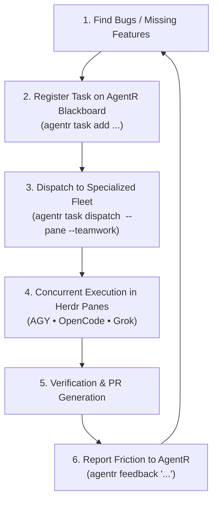

# Multi-Agent Orchestration & Native Frameworks Guide 🛰️🤖

This guide explains how to orchestrate multiple AI coding agents across **AgentDesk**, **AgentR**, **Herdr**, and native agent frameworks (such as Antigravity `/teamwork` and OpenCode).

---

## 1. The 4-Tier Orchestration Stack

```mermaid
flowchart TD
    Tier1[\"Tier 1: AgentDesk Mobile & Desktop Cockpit<br>(Live streaming peek, priority attention sorting, swarm radar, touch approvals)\"]
    Tier2[\"Tier 2: AgentR Switchboard & Coordination Hub<br>(Global Blackboard .agentr/tasks.json, session search, context relay, task dispatch)\"]
    Tier3[\"Tier 3: Herdr Terminal Multiplexer<br>(Workspaces ~General, ~CAD, ~AgentR; split panes w7:p1, w7:p2; socket RPC)\"]
    Tier4[\"Tier 4: Heterogeneous Agent Fleet & Native Systems<br>(AGY /teamwork, AGY subagents, OpenCode DeepSeek, Freebuff, Grok)\"]

    Tier1 <-->|HTTP REST & SSE Events| Tier2
    Tier1 <-->|Socket RPC pane.read / pane.close| Tier3
    Tier2 <-->|Dispatch & Handoffs| Tier3
    Tier3 <-->|Terminal PTY execution| Tier4
```

| Tier | Role | Responsibility |
|---|---|---|
| **Tier 1: AgentDesk** | **Remote Cockpit** | Mobile/desktop web UI on port 9876. Live streaming output, instant tool approvals, attention-first card sorting, and swarm radar. |
| **Tier 2: AgentR** | **Meta-Orchestrator** | Shared project blackboard (`BOARD.md`), task queue, live context snapshots (`.agentr/live_context.json`), token cascading, and task dispatcher. |
| **Tier 3: Herdr** | **Terminal Multiplexer** | Manages workspaces (`~CAD`, `~General`, `~AgentR`) and side-by-side terminal panes. Provides socket RPC for reading/writing buffers without killing agents. |
| **Tier 4: Agent Fleet** | **Specialized Execution** | Distinct coding engines and native multi-agent systems executing tasks concurrently. |

---

## 2. Intra-Agent vs. Inter-Agent Multi-Agent

There are two levels of multi-agent collaboration:

### A. Intra-Agent: Native Systems inside Antigravity (`agy`)

Antigravity features built-in multi-agent primitives running inside a single agent session:

#### 1. The `/teamwork` Subagent System
The `/teamwork` system is triggered via the `/teamwork` slash command or by delegating to the `teamwork_preview` subagent. It supports four team structures:

1. **Small, Focused Team (Default for bug fixes)**:
   - **Structure**: One primary implementer + repeated adversarial reviewers.
   - **Prompt Trigger**: Open the prompt with `"This is a single self-contained fix; keep it small and focused."`
   - **Best for**: Contained bug fixes, targeted refactors, single-component additions.
2. **Full Team**:
   - **Structure**: Multi-phase team (architect, researchers, multiple implementers, QA).
   - **Prompt Trigger**: Standard multi-requirement prompt without the small-team prefix.
   - **Best for**: Major feature builds, multi-package changes, new services.
3. **Large-Scale Swarm Team**:
   - **Structure**: 100+ concurrent agents exploring search spaces in parallel.
   - **Prompt Trigger**: Open the prompt with `"Use a very large team of agents."`
   - **Best for**: Complex mathematical problem solving, formal verification, theorem proving.
4. **Document Review Team**:
   - **Structure**: Multi-perspective review pipeline for whitepapers, RFCs, and API specs.

#### 2. Native Subagents (`invoke_subagent`)
Antigravity can dynamically invoke subagents in the background:
- `research`: Read-only codebase explorer and file scanner.
- `self`: Full-capability subagent inheriting parent tools and model.
- `define_subagent`: Define custom specialized agent roles on the fly.
- Subagents run non-blocking in the background; the parent agent is awakened reactively upon task completion.

---

### B. Inter-Agent: Heterogeneous Swarms across Different Engines

Different AI coding agents possess distinct strengths, price points, and quota tiers:

- **Antigravity (`agy`)**: High-context reasoning, deep architectural design, and native `/teamwork` verification.
- **OpenCode (`opencode`)**: High-speed AST edits and repetitive refactoring running free on DeepSeek Flash.
- **Grok Build (`grok`)**: Rapid alternative perspectives and triage.
- **Freebuff (`freebuff`)**: Offline/local tool calling.

AgentR binds these engines together using the shared **Blackboard** and **Herdr Panes**.

---

## 3. How to Orchestrate Agents via AgentR

### 1. Adding Tasks to the Blackboard
Add tasks from your terminal or from inside an agent prompt:

```bash
# Add a bug fix assigned to OpenCode with Grok as reviewer
agentr task add "Align single-axis restriction (X/Y/Z) parameters" \
  --agent opencode \
  --review grok \
  --desc "Implement inverse projection on rotated component frames in crates/engine"

# Add an architecture task assigned to AGY
agentr task add "Redesign sketch text bold capability detection" \
  --agent agy \
  --desc "Disable bold toggle when font has no bold face"
```

### 2. Dispatching Tasks into Side-by-Side Herdr Panes (`--pane`)
Instead of blocking the calling terminal with `os.execvp`, AgentR can split your current Herdr workspace and start the agent in an adjacent pane:

```bash
# Split the current workspace and run OpenCode in the new pane
agentr task dispatch task-16 --pane

# Dispatch into a dedicated workspace
agentr task dispatch task-15 --workspace "CAD-Workers"
```

The dispatched agent starts immediately in its own terminal pane, visible on your workstation screen and inside AgentDesk. The calling agent remains alive and free to continue working.

### 3. Dispatching Native `/teamwork` Tasks
When assigning a task to `agy`, you can instruct AgentR to automatically structure the briefing according to Antigravity's `/teamwork` protocol:

```bash
# Formats prompt with small focused team directive + Acceptance Criteria
agentr task dispatch task-15 --teamwork small --pane

# Full team build
agentr task dispatch task-17 --teamwork full --pane
```

AgentR formats the prompt following the required `/teamwork` specification:
```text
This is a single self-contained fix; keep it small and focused.

Goal: Redesign sketch text bold capability detection
Working directory: /home/ashish/Work/solidcraft-upstream
Integrity mode: development

## Requirements
### R1. Primary Deliverable
Disable bold toggle in Edit Text dialog when font has no bold face.

## Acceptance Criteria
### Verification
- [ ] Code compiles and passes all local test suites without regressions
- [ ] Implementation addresses the issue cleanly with zero unexpected side effects
- [ ] Update AgentR board: `agentr task update task-15 done`
```

---

## 4. The Continuous Autonomous Loop

When orchestrating a full project (e.g. SolidCraft CAD or PhoneHerdR), agents should follow this high-level loop:



1. **Lead Agent / Architect**: Identifies backlog issues or issues filed by users.
2. **Registers on Blackboard**: Runs `agentr task add "<title>" --agent <opencode|agy> --desc "<details>"`.
3. **Dispatches to Herdr Panes**: Runs `agentr task dispatch <id> --pane`, spawning workers in side-by-side terminal panes.
4. **Self-Healing & Platform Feedback**: If a worker agent encounters platform friction or bugs in `agentr`, it runs:
   ```bash
   agentr feedback "Explain bug or missing capability"
   ```
   A dedicated workspace (`~AgentR`) picks up the feedback, implements the fix, runs `./run_tests.sh`, and pushes the improvement live!
5. **Monitoring on AgentDesk**:
   - Tab **`1:PANES`**: Live streaming peek into every active agent pane.
   - Tab **`2:SESSIONS`**: Unified search across all past transcripts.
   - Tab **`3:SWARM`**: Animated topology radar showing active agents and PR links.
   - Tab **`4:GUIDE`**: Interactive orchestration cheat sheet.

---

## 5. Troubleshooting & Best Practices

- **Never inject test input into active agent panes**: Test suites must only target dedicated shell panes (e.g. `w8:p3`) or mock panes. Keystrokes sent to active agent panes interrupt their conversational turns.
- **Keep Herdr panes visible**: Splitting panes (`--pane`) ensures every agent has its own PTY, allowing Herdr to stream output and track process lifecycles.
- **Use Free Tier models for grunt work**: Assign high-volume AST edits to OpenCode with `deepseek-v4.1-flash` (`--agent opencode`) to conserve token quotas on flagship models.
- **Specify What, Not How**: In `/teamwork` tasks, define clear acceptance criteria and verification commands (e.g., `cargo test -p engine`), allowing the agent team to find the optimal implementation.
